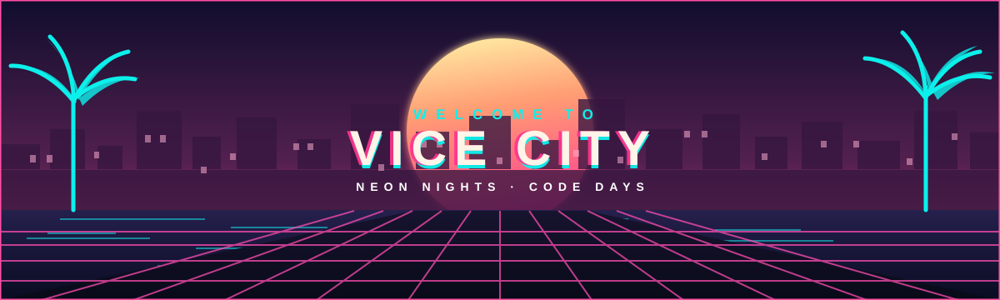

# MIGUEL OLIVEIRA
### DESENVOLVIMENTO • NEON NIGHTS • VICE CITY

**ADS na Faculdade Flamingo** · **Formação PROA** · **Em busca de estágio em desenvolvimento**

---

## Sobre mim

Estudante de **Análise e Desenvolvimento de Sistemas** e formado pelo **Instituto PROA** em tecnologia. Busco estágio em desenvolvimento de software, com interesse em aplicações web e **C#/.NET**.

## Stack

## Projetos

- [API Pokémon](https://github.com/migueLLIDO/API-Pokemon)
- [Rick and Morty API](https://github.com/migueLLIDO/RickAndMorty-API)
- [Conversor de moedas](https://github.com/migueLLIDO/Conversor-Moedas)
- [Deixe-me ir](https://github.com/migueLLIDO/Deixe-me_ir)

## Formação

- **Análise e Desenvolvimento de Sistemas** — Faculdade Flamingo (cursando)
- **Formação em Tecnologia** — Instituto PROA

## GitHub

**MIAMI AFTER DARK // CODE ALL DAY**

